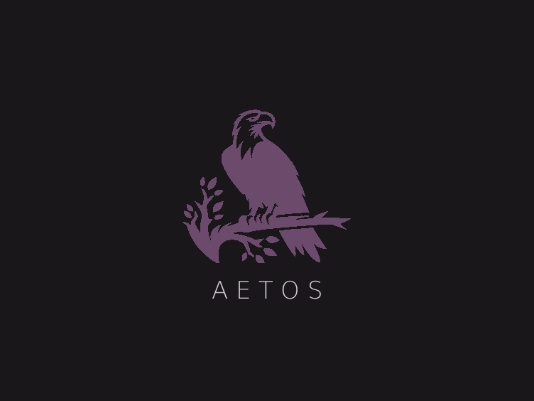
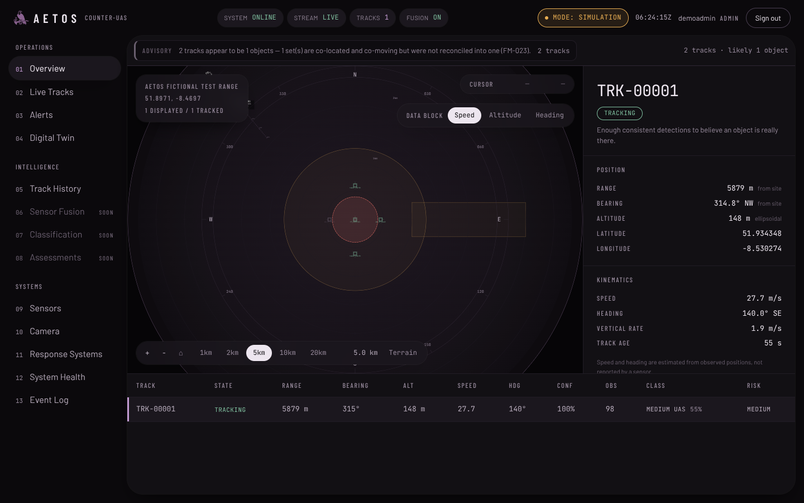

<p align="center">
  
</p>

<h1 align="center">Aetos</h1>

<p align="center">Command and control software for counter-drone teams.</p>

Drones turn up over airports, prisons and power stations all the time now. The sensors to spot
them already exist. What I kept seeing missing was the layer in between: something that takes
noisy detections from several different sensors, works out which ones are the same drone,
decides whether it's actually a threat, and shows the person on duty something they can act on
without second-guessing it.

So I built Aetos.



<sub>One drone, seen by three sensors, fused into one track. The amber SIMULATION badge comes
from the backend, based on which sensors are actually attached, not from the interface.</sub>

## What it does

Aetos takes raw detections, turns them into tracks, classifies them, scores the risk, and gives
the operator a recommendation. Every judgement comes with its reasons, and every event goes into
an append-only log, so I can replay any decision afterwards and show exactly why it was made.

```
sensor → normalise → associate → track → classify → assess risk → recommend → operator
```

Each step is its own module. The tracker can't tell a simulated detection from a real one: both
come in through the same adapter in the same format, and a test makes sure it stays that way.
So what you see in simulation is the same code path a real sensor goes through.

## What it won't do

Aetos is software only, and it stops at a recommendation. No effector control, no weapons, no
autonomous response. The strongest thing it will ever say is `RESPONSE_RECOMMENDED`, and that's
advice to a human. I made that a hard line on purpose. It isn't a missing feature.

## Try it

```bash
./start.sh
```

Then open **http://localhost:8000**. That one command sets up Python, builds the interface and
starts everything. You need Python 3.11+ and Node 20+. On Windows, run it from Git Bash.

```bash
./start.sh --list              # the nine built-in scenarios
./start.sh h_track_crossing    # run one
./start.sh --live              # a real radar instead of the simulator
```

Out of the box, everything is synthetic. Live mode runs against a testbed radar, but I haven't
measured its detection performance yet, so for now it proves the pipeline, not the sensor. More
in [docs/live_mode.md](docs/live_mode.md).

Tests: `pytest -q` for the backend, `cd frontend && npm test` for the console.

## Running it for real

Aetos needs a login (viewer, operator and admin roles) and keeps an audit trail of who did what.
It won't start in a setup I consider unsafe: it only listens on localhost unless you put it
behind a TLS reverse proxy and pass `--behind-proxy`. Create the first account with:

```bash
.venv/bin/python -m backend.auth.admin add --username alice --role admin
```

The full checklist is in [docs/deployment.md](docs/deployment.md).

## Put it online

[](https://render.com/deploy?repo=https://github.com/ahroonsanthosh/Aetos)

No terminal needed. Click the button, sign in to Render with GitHub, and fill in an admin
username and a password of 12 characters or more. A few minutes later you get an
`https://aetos-xxxx.onrender.com` address with the sign-in screen and the simulated approach on
a loop. The viewer username and password are optional: they make a read-only account you can
hand to someone else.

It runs on Render's free plan, which sleeps after 15 minutes without visitors and takes about a
minute to wake. Each wake starts a fresh event log. The same image runs on any host that
terminates TLS in front of it; see [docs/deployment.md](docs/deployment.md#hosted-render-fly-railway). Please read
[docs/failure_modes.md](docs/failure_modes.md) before you rely on it anywhere that matters.
I write down every way I've found it can go wrong, including the ones I haven't fixed.

## What it can't do yet

- The radar in live mode is a testbed unit with unmeasured detection performance.
- The 3D digital twin (Digital Twin in the console's menu) runs its own simulated scenario. It
  isn't fed by the console's live tracks yet.
- The camera (Camera in the menu) uses your device's camera and measures direction only. It
  places what it sees at a range you choose, so treat its tracks as bearings, not positions.
- One drone sometimes still shows as more than one track for a moment, while the evidence that
  two tracks are the same object builds up. It's one row about 94 % of the time now, up from 43 %.

If it breaks, [open an issue](https://github.com/ahroonsanthosh/Aetos/issues). Found a security
problem? See [SECURITY.md](SECURITY.md).

## What's where

| Path        | What's there                                                                  |
| ----------- | ----------------------------------------------------------------------------- |
| `backend/`  | Ingestion, tracking, fusion, classification, zones, risk, decision, event log |
| `sensors/`  | The sensor adapter contract, the simulator and the testbed radar driver       |
| `frontend/` | The operator console                                                          |
| `twin/`     | The 3D digital twin, served by the backend at `/twin/`                        |
| `docs/`     | Architecture, schema, failure modes and design decisions (`docs/adr/`)        |

## Where it's going

It's just me working on this, and it's in active development. Next up: fusion across more
sensors, a digital twin of the site, distributed nodes and coordination across sites. The longer
version is in [docs/vision.md](docs/vision.md), and where each module stands today is in
[docs/architecture.md](docs/architecture.md). Changes are in [CHANGELOG.md](CHANGELOG.md).

## License

GPL-3.0-or-later. See [LICENSE](LICENSE).
