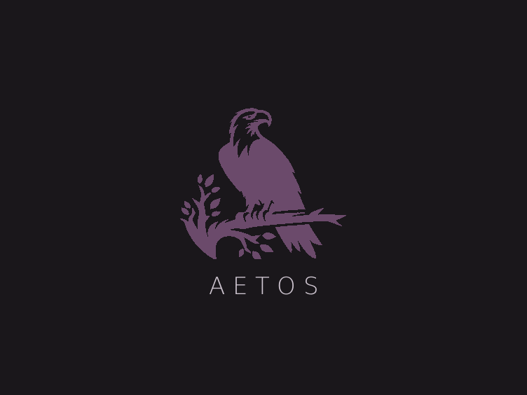
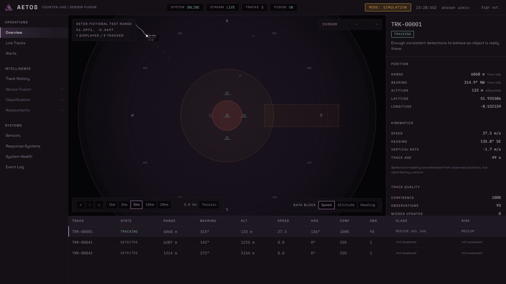

<p align="center">
  
</p>

# Aetos — Counter-UAS Command & Control Platform

**Aetos turns raw drone-sensor detections into tracked, classified, risk-scored threats and
gives a human operator a recommendation they can audit.** Every judgement carries its
reasons, and every event lands on an append-only log.



<sub>The operator console during a simulated approach: one drone, seen by three sensors and
fused into one track. The amber badge says SIMULATION because this is synthetic data; the badge
is set by the backend from the sensors actually attached, not by the interface. Also:
[the front page](docs/assets/landing.png) · [system health](docs/assets/system-health.png).</sub>

Aetos is a modular Counter-UAS (C-UAS) command-and-control platform. It ingests detections
from sensors, forms and maintains tracks, classifies them, assesses risk against a
configured protected site, and presents a human operator with a **recommendation**.

## Scope boundary — read this first

Aetos is **software only**. It stops at a human-facing recommendation.

- No effector control. No weapons integration. No autonomous response execution.
- The highest-severity output the system can produce is the recommendation category
  `RESPONSE_RECOMMENDED`, which is advice to a human operator and nothing more.
- This is a hard architectural boundary, not a phase-one simplification. Response and
  effector integration is a separate future system with its own authorisation and safety
  architecture, and does not belong in this codebase.

By default every detection is **synthetic**, from a built-in simulator. Aetos can also run
against a real radar — `./start.sh --live`, see **[docs/live_mode.md](docs/live_mode.md)** —
but that hardware is a testbed unit whose detection performance has never been measured
(FM-050, FM-052). Live mode makes the system usable; it does not make the sensor trustworthy.

## Core principle

The tracking engine cannot tell whether a detection came from the simulator or from a
physical sensor. Both produce the same canonical `Detection` through the same
`SensorAdapter` interface. This is enforced by test, not by convention — see
`docs/adr/0002-detection-schema-provenance.md`.

## Pipeline

```
sensor adapter → normalisation → association → track → classification
              → risk assessment → decision support → operator
```

Each arrow is a module boundary with an explicit interface. They are never collapsed into
a single combined pipeline function.

## Repository layout

| Path | Responsibility |
|---|---|
| `docs/` | Architecture, canonical schema, failure modes, decision records |
| `backend/common/` | Cross-cutting primitives: clock, geodesy, identifiers, config |
| `backend/ingestion/` | Detection validation and normalisation; event-bus entry point |
| `backend/tracking/` | Association, filtering, lifecycle, prediction |
| `backend/fusion/` | Multi-sensor reconciliation |
| `backend/classification/` | What the object is, and how confident |
| `backend/zones/` | Site geometry, geofencing, zone-crossing prediction |
| `backend/risk/` | Threat scoring with reason codes |
| `backend/decision/` | Recommendation category only — never execution |
| `backend/events/` | Append-only durable event store; replay |
| `backend/system_health/` | Watchdog: judges sensor silence, declares the posture, detects a stalled pipeline |
| `backend/database/` | Persistence adapters |
| `backend/api/` | REST + WebSocket |
| `sensors/` | `SensorAdapter` contract, simulated adapter, testbed radar driver |
| `scenarios/` | Named, reusable scenario definitions |
| `frontend/` | Aetos operator interface — see its own README |
| `twin/` | 3-D digital-twin command interface. **Standalone prototype**, not yet wired to the backend |
| `response/` | **Empty placeholder.** Future response integration; see its README |
| `config/` | Sites, sensor registry, environment configuration |
| `tests/` | Unit, integration, scenario replay, chaos |

## Running it

One command. It sets up Python, builds the interface, starts everything and opens a browser.

```bash
./start.sh
```

Then **http://localhost:8000** — a single process serves both the API and the operator
interface, so there is no second terminal and no proxy to configure.

```bash
./start.sh --list                  # show the nine scenarios and what each one is for
./start.sh h_track_crossing        # run a specific one
./start.sh --no-scenario           # idle system, no synthetic data
./start.sh --live                  # real radar instead of the simulator
./start.sh --port 9000             # serve somewhere else
```

Needs Python 3.11+ and Node 20+. Re-running is cheap: it skips whatever is already done.

### Windows

`start.sh` is a bash script — run it from **Git Bash**, not PowerShell or cmd.exe. If you
cloned with `git clone`, you already have Git for Windows installed, which includes it:
right-click the repository folder and choose **Git Bash Here**, then run `./start.sh` exactly
as above. It handles the Windows-specific paths (`.venv\Scripts\`) and opens your default
browser itself.

There is no native PowerShell equivalent yet. If you'd rather not install or use Git Bash, say
so and one can be added — but treat that as untested until it has actually been run on
Windows (FM-040 has the same caveat for the container files).

### Tests

```bash
pytest -q                      # backend
cd frontend && npm test        # interface
```

## Before you put this anywhere

**Aetos requires a login, and refuses to start in a configuration that would expose it.**
Session cookies, three roles (`viewer` / `operator` / `admin`), scrypt password hashing, and
an audit trail that records who logged in, who acknowledged what, and when.

It does **not** terminate TLS. It binds loopback by default and refuses to bind anything else
without `--behind-proxy`, which is your assertion that a reverse proxy in front of it is
handling TLS. It also refuses to start unauthenticated off loopback, or with no accounts at
all. Create the first account before deploying:

```bash
# Use the interpreter inside .venv, not the bare `python` on PATH — the dependencies live
# there. On Windows the layout is Scripts, not bin.
.venv/bin/python -m backend.auth.admin add --username alice --role admin           # Linux, macOS
.venv/Scripts/python.exe -m backend.auth.admin add --username alice --role admin   # Windows
```

`./start.sh` prints the correct command for your machine if no account exists yet.

**[docs/deployment.md](docs/deployment.md)** has the proxy configuration and a post-deploy
checklist. [ADR 0016](docs/adr/0016-authentication-and-authorisation.md) explains the design;
`docs/failure_modes.md` FM-001 records what this replaced.

For a single-user machine, `--no-auth` restores the old behaviour — every action attributed to
one local operator with nothing checked. It works on loopback only, and `GET /system/health`
says so in as many words when it is in use.

**Read `docs/failure_modes.md` before relying on this.** Authentication is closed; sensor
silence, restart recovery and saturation are not, and they matter more on a site than on a
laptop.

## Status

Under active construction. See `docs/architecture.md` for the current state of each module
and `docs/adr/` for why things are built the way they are.

## Where this is going

`docs/vision.md` records the long-term product vision — hardware-agnostic sensor integration,
multi-sensor fusion, a site digital twin, asset-aware protection, distributed nodes, fleet
and cross-site coordination, and the rest. It is **aspirational**, marks the build status of
every capability, and does not relax the scope boundary above: the response capabilities it
describes are decision support, and `RECOMMENDED`, `AUTHORISED` and `EXECUTED` remain three
distinct states with three distinct authors.

The digital twin is the furthest along of those: `twin/` is a standalone 3-D command interface
prototype with its own simulator, developed on its own until it is ready to be wired to the
backend. See `twin/README.md`.
